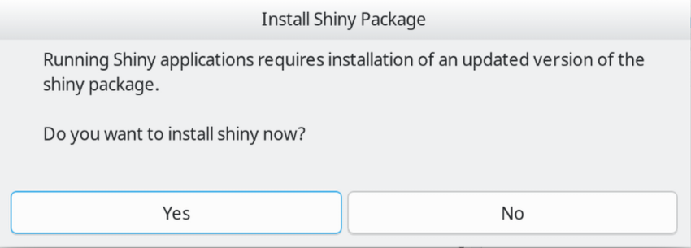

---
output:
  html_document: default
  pdf_document: default
---

# RECAN_scaling_app_renku: Files for deployment of the RECAN-scaling app on the Renku platform

This repository contains the files of the RECAN-scaling Shiny application developed by Alvin Walker
and some additional files (Procfile.txt, environment.yml) for deployment on the Renku (https://renkulab.io/) platform.

Useful links for app deployment on Renku:

https://docs.renkulab.io/en/latest/docs/users/compute/app/guides/host-app/

https://docs.renkulab.io/en/2.16.2/docs/users/sessions/guides/create-custom-environment-and-launcher-for-shiny-app/

Creator of repository: Manuela Ott

Date: 21.10.2026


# Documentation of the Shiny application

## **RECAN-scaling: Shiny web application for the scaling of recruitment rates in predictions at the design of medical studies**

#### **Probabilistic predictions of recruitment time and subject count based on a Poisson process with a constant recruitment rate over time**

<br>

#### **Authors:** Alvin Walker, Katarina Zatkova, Manuela Ott, Malgorzata Roos

#### **Date:** 1st of September 2026

<br>

This file is part of a record published on Zenodo (https://doi.org/10.5281/zenodo.22145326).


## **License**

R code and Shiny application: GNU Affero General Public License >= 3 (https://www.gnu.org/licenses/licenses.html.en#AGPL)

SPDX-License-Identifier: AGPL-3.0-or-later

<br>

## **Introduction**

This Shiny application is a user-friendly, interactive tool that scales 
recruitment rates which are constant over time and generates probabilistic 
predictions that account for the inherent stochastic variability of the 
recruitment process. Users without coding experience or statistical expertise 
can use it to assess how increasing or decreasing the recruitment rate value 
by a scaling factor affects predictions of recruitment time and subject counts.
Users can interactively change their assumptions to instantly obtain updated plots,
estimates, and interpretations. This enables them to efficiently make informed 
decisions accounting for the stochastic variability of recruitment processes 
when designing and planning medical studies.

<br>

## **Disclaimer**

The predictions provided by this Shiny application are only as reliable
as the information given as input by the user. Moreover, they apply only
if the recruitment rate is approximately constant over time. The authors of
this Shiny application take no responsibility for decisions
made using its outputs.

<br>


## **Folder organization**

**app.R**: Contains all code for the Shiny application

[comment]: <> (**LICENSE.txt**: Contains information about the distribution license of this software)

**examples**: Includes screenshots of inputs and outputs for the 4 examples described in Walker et al. (2026)  

**www**: Contains all images used by the application, is needed for full functionality of the application

```
.
├── app.R
├── README.html
├── LICENSE.txt
├── examples
│   └── ...
└── www
    ├── converting
    │   └── ...
    └── recan_logo.png
```

<br>


## **Instructions: Installing the application**

#### **Setting up R**

To run this application, the free-of-charge [R](https://cran.r-project.org/) software is required. 
In addition, five R packages are required: 
"bslib", "kableExtra", 
"knitR", "shiny" and "shinyscreenshot". 
We also recommend installing [RStudio](https://posit.co/download/rstudio-desktop/) for ease of use.

We recommend installing the software in the following order:

1.  [R](https://cran.r-project.org/)

2.  [RStudio](https://posit.co/download/rstudio-desktop/)

3.  the five packages using the following command:

```
install.packages(c("bslib", "kableExtra", "knitr", "shiny", "shinyscreenshot")) 
```

<br>


#### **Launching the application**

First, extract the files and folders from the downloaded ZIP file.

This app can then be launched and used as follows:

**Using RStudio:**

1. Open the file "app.R" in RStudio

2. Click on the "Run App" button on the top right of the screen

<center>
{width=60%}
</center>

<br>


**Using the R console:**

1. Set the working directory to the directory in which the file "app.R" is stored

2. Run the following code

```
shiny::runApp('./app.R')
```
3. Copy the displayed URL and paste it in a browser.

<br>


**Using the terminal:**

1. Navigate to the directory in which the file "app.R" is stored

2. Run the following code

```
R -e "shiny::runApp('./app.R')"
```
3. Copy the displayed URL and paste it in a browser.

<br>

**Warning**: After launching the application, a message may appear 
saying that an updated version of the "shiny" package is needed.
In this case, install the updated version.

<center>
{width=40%}
</center>

<br>

#### **Terminating the application**

Close the window or browser tab in which the application is running.

<br>

## **Instructions: Using the application**

### **Hints for scaling the page**

If the app has been launched from RStudio, it will open in a separate RStudio window.
To ensure good sizing of the page, click on the "Open in Browser" button in that window.
Once the app is displayed in the browser, use the integrated zoom function of the browser to resize the content.

<center>
{width=30%}
</center>

<br>


### **Structure**

The application is organised in two main tabs. 
The "Scaling of recruitment rate" tab enables users
to quantify the impact of scaling recruitment rate by a factor $f$ on the recruitment
counts and recruitment time. The factor $f$ can represent either an administrative action that increases
recruitment rate and speeds up recruitment, or in opposition a retention factor that reduces
recruitment rate and lengthens the recruitment. The "Converting time units" tab uses the scaling factor
$f$ to convert time units between days, weeks, months, and years. This enables users
to shift the time unit of the prediction into their preferred modelling scale.


To model recruitment time and subject count, this application uses a homogeneous 
Poisson process with a recruitment rate $\lambda$ which is constant over time (Carter, 2004).

<br>


### **Input**

**Recruitment rate $\lambda$**:  Expected recruitment rate for the planned study = expected subject count per unit of time.

**Unit of time**: Unit in which the study recruitment is planned (e.g. days, months, years).

**Counting unit**: Unit in which study subjects are counted in plural form (e.g. participants, patients).

**Target count $\text{C}_{\text{target}}$**: Target recruitment count (sample size) of the study.

**Target time $\text{T}_{\text{target}}$**: Target recruitment duration of the study in the chosen unit of time.

**Scaling factor $f$ **: Factor > 0 by which an intervention increases or reduces recruitment rate. 
Will be calculated from the scaled recruitment rate $\lambda_{\text{scaled}}$ if that value is specified.

**Scaled recruitment rate $\lambda_{\text{scaled}}$**: Recruitment rate $\lambda_{\text{scaled}} = f \cdot \lambda$ 
obtained by applying the scaling factor $f$ to the original recruitment rate. 
Will be calculated from the scaling factor $f$ if that value is specified.

<br>

### **Output**

**Cumulative recruitment plot**: Uncertainty bands for the cumulative subject count recruited over time. 
The inner band shows central 50% prediction intervals and the outer band central 95% prediction intervals.

**Summary**: Accessible and non-technical description of results to help interpretation.

**Quantiles table**: Values of the count at $\text{T}_{\text{target}}$ and the time to recruit $\text{C}_{\text{target}}$ subjects, 
corresponding to fixed probabilities of achieving them.

**Distributions**: Visualizations of the predictive distribution of the cumulative subject count at time $\text{T}_{\text{target}}$ 
and of the predictive distribution of time to recruit $\text{C}_{\text{target}}$ subjects.

* **For time**: Density of the predictive distribution of time to recruit $\text{C}_{\text{target}}$ subjects.

* **For counts**: Probability mass function 
of the predictive distribution of the count at time $\text{T}_{\text{target}}$.

**Cumulative distributions**: Alternative visualization of the predictive distributions 
of the count at $\text{T}_{\text{target}}$ and of the time to recruit $\text{C}_{\text{target}}$ subjects. 

<br>

### **Examples**

The folder "examples" contains screenshots of the input and output for the 4 examples described in Walker et al. (2026), for both time and count.
The values of the expected recruitment rate $\lambda$, the target subject count $\text{C}_{\text{target}}$ 
and the target recruitment duration $\text{T}_{\text{target}}$
are taken from an example in Carter (2004).
These are also set as the default values for these parameters in the Shiny application.

**Examples 1-3** illustrate the functionality of the "Scaling of recruitment rates" tab.
Examples 1 and 2 focus on administrative actions to increase recruitment rates.
Example 3 considers a reduced recruitment rate due to patient leakage during the study duration. **Example 4** illustrates the functionality of the "Converting time units" tab.
In this example, the time unit is converted from days to months.

We use the following scaling factors $f$ from the literature in examples 1-3:

| Intervention | Scaling factor $f$ | Reference |
|:------------ |:------------------:|:----------|
| Open-trial rather than blinded | 1.1 | Treweek et al. (2018) |
| Telephone reminder to non-respondents | 1.06 | Treweek et al. (2018) |
| Retention rate | 0.89 | Walters et al. (2017) | 


<br>

### **Extra considerations**

**Exporting outputs**

All outputs can directly be exported to PNG files by pressing the "export" button on the bottom left corner of the pages.
Pressing this bottom will generate a screenshot of the displayed tab (only the visible parts on the screen). 
For further help, see the [subsection on scaling the page](#hints-for-scaling-the-page).


**Converting time units while predicting counts**

Converting time units while predicting counts has no effect on the probabilistic
prediction generated by this application. This is expected behavior as, for example, predicting the count of
participants recruited in 2 weeks is equivalent to predicting the number of 
participants recruited in 14 days.


<br>


## **Citation**

This Shiny application is introduced in the manuscript: 

*Walker, A., Zatkova, K., Ott, M., Roos, M. (2026). Scaling recruitment rates made easy: 
Open-source Shiny web application for interactive recruitment time and participant
count predictions using a homogeneous Poisson process. In preparation.*

Cite using BibTex as:

```BibTex
@unpublished{walker2026RECANscaling,
  author = {Walker, Alvin and
            Zatkova, Katarina and
            Ott, Manuela and 
            Roos, Malgorzata},
  title  = {Scaling recruitment rates made easy: Open-source Shiny web application for interactive recruitment time and participant count predictions using a homogeneous Poisson process},
  year   = {2026},
  note   = {in preparation}
}
```

<br>


## **Acknowledgements** 

This Shiny application was created as a part of the DSRA project funded by the
Swiss National Science Foundation (\# 10002316). The work of Alvin Walker was
funded by Professor Leonhard Held, the head of the Biostatistics Department at the
Biostatistics, Prevention and Epidemiology Institute at the University of Zurich.

<br>

## **References**

Carter, R. E. (2004). Application of stochastic processes to participant recruitment in
clinical trials. Controlled Clinical Trials, 25(5), 429–436. https://doi.org/10.1016/j.cct.2004.07.002.

Treweek, S., Pitkethly, M., Cook, J., Fraser, C., Mitchell, E., Sullivan, F., Jackson, C., Taskila, T. K., & Gardner, H. (2018). 
Strategies to improve recruitment to randomised trials. Cochrane Database of Systematic Reviews.
https://doi.org/10.1002/14651858.MR000013.pub6.


Walters, S. J., Henriques-Cadby, I. B. dos A., Bortolami, O., Flight, L., Hind, D., Jacques,
R. M., Knox, C., Nadin, B., Rothwell, J., Surtees, M., & Julious, S. A. (2017).
Recruitment and retention of participants in randomised controlled trials: 
A review of trials funded and published by the United Kingdom Health Technology Assessment Programme.
BMJ Open, 7(3), e015276. https://doi.org/10.1136/bmjopen-2016-015276.


<br>
<details>
<summary>Reproducibility</summary>
<br>
sessionInfo():

R version 4.6.1 (2026-06-24)
Platform: x86_64-pc-linux-gnu
Running under: Ubuntu 24.04.4 LTS

Matrix products: default
BLAS:   /usr/lib/x86_64-linux-gnu/blas/libblas.so.3.12.0 
LAPACK: /usr/lib/x86_64-linux-gnu/lapack/liblapack.so.3.12.0  LAPACK version 3.12.0

locale:
 [1] LC_CTYPE=en_US.UTF-8       LC_NUMERIC=C               LC_TIME=en_US.UTF-8       
 [4] LC_COLLATE=en_US.UTF-8     LC_MONETARY=en_US.UTF-8    LC_MESSAGES=en_US.UTF-8   
 [7] LC_PAPER=en_US.UTF-8       LC_NAME=C                  LC_ADDRESS=C              
[10] LC_TELEPHONE=C             LC_MEASUREMENT=en_US.UTF-8 LC_IDENTIFICATION=C       

time zone: Europe/Zurich
tzcode source: system (glibc)

attached base packages:
[1] stats     graphics  grDevices utils     datasets  methods   base     

other attached packages:
[1] shinyscreenshot_0.2.1 bslib_0.12.0          knitr_1.51            kableExtra_1.4.1     
[5] shiny_1.14.0         

loaded via a namespace (and not attached):
 [1] jsonlite_2.0.0     compiler_4.6.1     promises_1.5.0     Rcpp_1.1.1-1.1     xml2_1.5.2        
 [6] stringr_1.6.0      later_1.4.8        jquerylib_0.1.4    systemfonts_1.3.2  scales_1.4.0      
[11] textshaping_1.0.5  fastmap_1.2.0      mime_0.13          R6_2.6.1           svglite_2.2.2     
[16] pillar_1.11.1      RColorBrewer_1.1-3 rlang_1.2.0        cachem_1.1.0       stringi_1.8.7     
[21] httpuv_1.6.17      xfun_0.57          fs_2.1.0           sass_0.4.10        otel_0.2.0        
[26] viridisLite_0.4.3  memoise_2.0.1      cli_3.6.6          withr_3.0.2        magrittr_2.0.5    
[31] digest_0.6.39      rstudioapi_0.18.0  xtable_1.8-8       lifecycle_1.0.5    vctrs_0.7.3       
[36] evaluate_1.0.5     glue_1.8.1         farver_2.1.2       ragg_1.5.2         rmarkdown_2.31    
[41] tools_4.6.1        htmltools_0.5.9   

</details>

<br>
